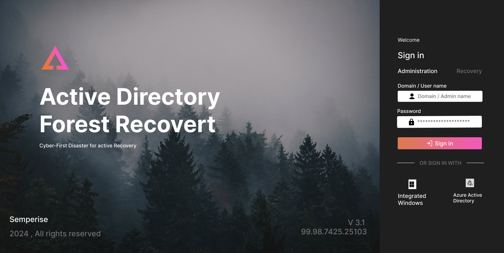

# Active Directory Forest Recovery — UI/UX Concept

A professional enterprise login interface concept designed in Figma for an Active Directory forest recovery workflow.

## Project Overview

This project explores a cybersecurity-inspired enterprise interface with a dark visual theme, forest imagery, and a dedicated authentication panel.

**Project type:** UI/UX Design Concept  
**Tool:** Figma  
**Focus:** Visual hierarchy, layout, typography, and enterprise interface design  
**Status:** Concept design

## Design Preview

## Design Goals

- Create a clear and structured login experience.
- Establish visual hierarchy between the product title and authentication panel.
- Use atmospheric imagery to support the cybersecurity theme.
- Present authentication options in an organized layout.

## Key UI Elements

- Product branding and title
- Administration and recovery navigation
- Username and password fields
- Sign-in action
- Alternative authentication options

## Design Process

1. Developed the visual direction and overall layout in Figma.
2. Organized the main interface into branding and authentication sections.
3. Applied typography, imagery, spacing, and contrast to improve readability.
4. Exported the design preview for portfolio documentation.

## Tools Used

- Figma — interface design and prototyping
- GitHub — project documentation and version history

## Figma Source

Add your Figma design link here: **[View the design in Figma]

## Disclaimer

This repository presents a visual UI/UX concept only. It is not a functional authentication system and does not implement Active Directory recovery or cybersecurity operations.
